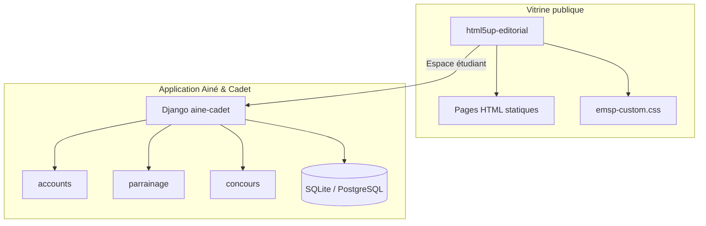
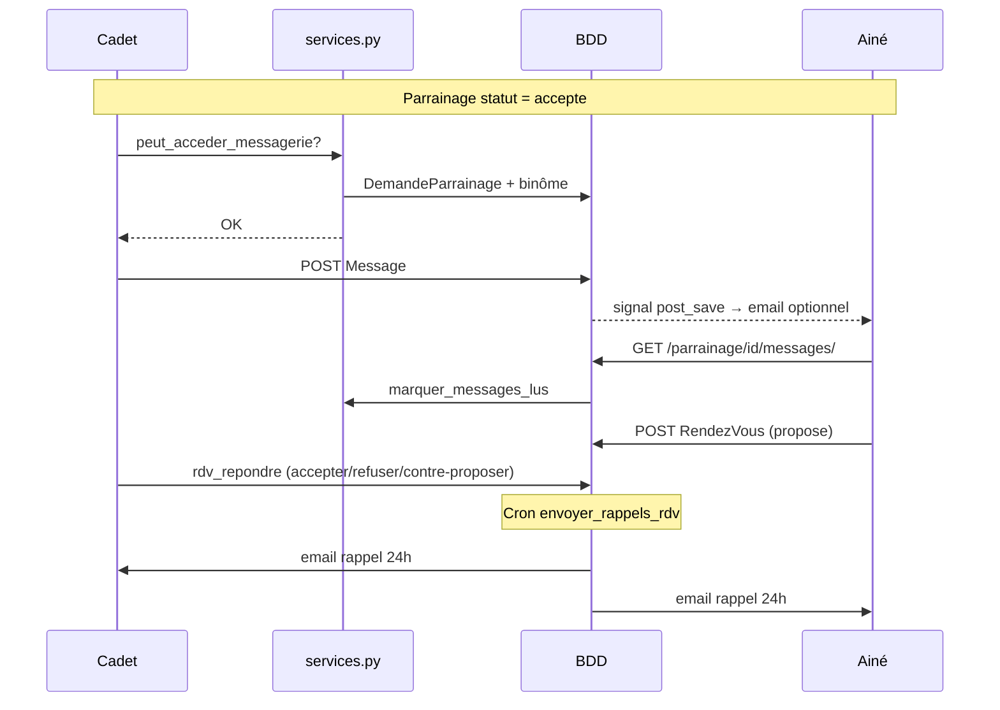

# Architecture — EMSPCONNECT

> Vue d'ensemble des deux composants du dépôt

---

## 1. Schéma global



---

## 2. Vitrine statique (`html5up-editorial/`)

| Couche | Technologie |
|--------|-------------|
| Markup | HTML5 (`lang="fr"`) |
| Styles | CSS3 + SASS + `emsp-custom.css` |
| Scripts | jQuery + `main.js` + `emsp-config.js` |
| Build | Aucun (fichiers servis tels quels) |

### Structure

```
html5up-editorial/
├── index.html                    # Accueil EMSP
├── formations-fs-menum.html      # Filière FS MENUM
├── assets/
│   ├── css/main.css              # Template Editorial compilé
│   ├── css/emsp-custom.css       # Charte EMSP
│   ├── js/emsp-config.js         # Config navigation partagée
│   └── images/                   # Logo + SVG placeholders
└── assets/sass/                  # Sources SASS (palette EMSP)
```

### Charte couleurs

```css
--emsp-green: #147c71;
--emsp-green-dark: #264719;
--emsp-yellow: #ef9c00;
--emsp-blue: #1a5276;   /* Espace étudiant */
```

---

## 3. Backend Ainé & Cadet (`aine-cadet/`)

| Couche | Technologie |
|--------|-------------|
| Framework | Django 5.x |
| Auth | Modèle utilisateur custom (`accounts.User`) |
| BDD dev | SQLite (`db.sqlite3`) |
| BDD prod | PostgreSQL (via `DATABASE_URL`) |
| Config | Variables d'environnement (`.env`) |

### Structure Django

```
aine-cadet/
├── manage.py
├── requirements.txt
├── .env.example
├── static/              # Logo Ainé & Cadet + CSS app
├── templates/           # Templates Django (Editorial)
├── config/
│   ├── settings.py      # APP_NAME, APP_SLUG, règles métier
│   ├── urls.py          # Routage racine
│   └── wsgi.py
    └── apps/
        ├── accounts/        # Utilisateurs, rôles, profils
        │   ├── models.py    # User, ProfilParrain (profil Ainé)
        │   └── validators.py
        ├── parrainage/      # Demandes, messages, RDV, avis, événements
        │   ├── models.py    # + AnneeAcademique
        │   └── services.py  # Règles R1–R6 (capacité Ainé, etc.)
        └── concours/        # Inscriptions concours d'entrée
            └── models.py    # InscriptionConcours
```

### Modèle relationnel (Phase 1–3)

```
User (1) ── (0..1) ProfilParrain (profil Ainé)
User (Cadet) ── (N) DemandeParrainage ── (1) User (Ainé)
DemandeParrainage (acceptée) ── (N) Message
DemandeParrainage ── (N) RendezVous
DemandeParrainage ── (0..2) Avis
User (Ainé) ── (N) BadgeAttribution
Evenement ── (N) InscriptionEvenement
AnneeAcademique ── (N) DemandeParrainage, Evenement, InscriptionConcours
ProfilParrain.reconduction_confirmee → archivage fin d'année
```

### Constantes métier (`config/settings.py`)

```python
PARRAIN_MAX_FILLEULS = 5          # Règle R2
SCHOOL_EMAIL_DOMAIN = "emsp.int"  # Règle R4 (configurable)
```

---

## 4. Intégration future vitrine ↔ backend

| Point d'entrée vitrine | Cible Ainé & Cadet |
|------------------------|------------------|
| `#menu .emsp-student-link` | `/accounts/login/` |
| CTA concours (`.emsp-concours-form-link`) | `/concours/inscription/` |
| Bibliothèque numérique | Zone authentifiée (Phase 3+) |

---

## 5. Déploiement

### Vitrine

Hébergement statique (Netlify, GitHub Pages, serveur nginx) — servir `html5up-editorial/`.

### Ainé & Cadet

- Serveur WSGI (Gunicorn) + PostgreSQL
- Stockage médias externe en production
- Variables : `SECRET_KEY`, `DATABASE_URL`, `SCHOOL_EMAIL_DOMAIN`

### Prévisualisation locale

```powershell
# Vitrine
cd html5up-editorial && python -m http.server 8080

# Backend
cd aine-cadet && python manage.py runserver
```

---

## 6. Compilation SASS (vitrine)

```powershell
cd html5up-editorial
npx sass assets/sass/main.scss assets/css/main.css
```

---

## 7. Flux communication (Phase 2)



### Endpoints Phase 2

| Route | Méthode | Description |
|-------|---------|-------------|
| `/parrainage/<id>/messages/` | GET/POST | Fil de conversation |
| `/parrainage/<id>/messages/marquer-lu/` | POST | JSON — marquer lu |
| `/parrainage/<id>/rdv/proposer/` | GET/POST | Nouvelle proposition |
| `/parrainage/<id>/rdv/<rdv_id>/<action>/` | GET/POST | accepter / refuser / contre-proposer |

---

## 8. Sécurité (Ainé & Cadet)

- Mots de passe : validateurs Django + hash PBKDF2
- CSRF activé sur tous les formulaires
- Accès messagerie : vérification parrainage accepté (service layer)
- Suppression compte : endpoint prévu Phase 4 (RGPD)
